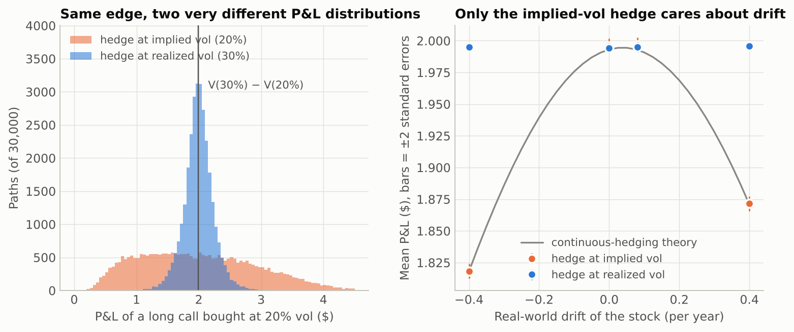

# GammaScalp

**How much risk is left after you delta-hedge an option, and do the textbook
formulas predict it?**

GammaScalp is a small option-pricing library and a hedging simulator. Five
studies test classical results against 12.6 million simulated hedging runs
(one hedger on one price path). Each study states a prediction from the
literature, simulates seeded paths, and reports both numbers side by side.

Everything here is synthetic. It checks formulas and code under stated models.
It is not a backtest and says nothing about whether a strategy makes money.



## Findings

Full write-up with tables: [`reports/GammaScalp_Research_Memo.md`](reports/GammaScalp_Research_Memo.md)
(also as a [PDF](reports/GammaScalp_Research_Memo.pdf))

1. **Hedging error falls like 1/√N.** A regression over 16 to 1,008 hedges
   gives a slope of −0.491 ± 0.001 against a theoretical −0.5. Daily hedging of
   a three-month option still leaves a standard deviation of 10% of the premium.
2. **The usual rule of thumb is an at-the-money result.** Derman and Kamal's
   `sqrt(pi/4) * vega * sigma / sqrt(N)` is within 0.3% at the money at 1,008
   hedges, but at strikes 10% away the simulated risk is 18% to 23% higher than
   it says. Summing the per-interval variance exactly (`leading_order_std`) is
   within 0.6% at all three strikes at 1,008 hedges, and within 2.2% at 63.
3. **Hedge at realized volatility to lock in an edge; hedge at implied and you
   keep the edge but not its size.** Buying at 20% when the stock realizes 30%
   earned $1.99 on average either way at the base-case drift. Hedging at
   realized vol had a standard deviation of $0.17; hedging at implied, $0.92,
   and its mean fell to $1.82 at a drift of -40%. It lost money on none of
   400,000 paths.
4. **Leland's volatility adjustment prices trading costs correctly.** With 10 bp
   costs it returned the seller's mean P&L to within 0.10% of the premium at
   every hedging frequency from 16 to 504.
5. **Hedging on a delta band beats hedging on a clock.** At equal average cost,
   the Whalley-Wilmott band carried 29% to 45% less risk.
6. **More hedging does not remove jump risk.** Going from 16 to 1,008 hedges cut
   hedging risk by 87% for a smooth stock and by 8% for a stock with jumps and
   the same total variance.
7. **A second-order drift effect.** A discretely hedged short option has a small
   negative bias proportional to `(mu - r)^2 * dt`. The derived formula matched
   simulation within 2.1 standard errors across eight cases.

## Run it

Requires Python 3.10 or newer. From this directory:

```bash
python3 -m venv .venv
source .venv/bin/activate
python -m pip install -e .
python -m unittest discover -s tests        # 58 tests, about 35 seconds
```

Quick calculations:

```bash
python -m gammascalp price --spot 100 --strike 100 --expiry 0.25 --vol 0.2 --rate 0.03
python -m gammascalp price --spot 100 --strike 110 --expiry 1 --vol 0.25 --rate 0.05 --put --american
python -m gammascalp iv --price 4.3576 --spot 100 --strike 100 --expiry 0.25 --rate 0.03
python -m gammascalp hedge --rebalances 63 --paths 50000
```

```text
short one 3-month at-the-money call, premium 4.3576, 63 hedges, 50000 paths
mean P&L           0.0030  (standard error 0.0019)
std of P&L         0.4352  (10.0% of premium)
theory             0.4420  (ratio 0.985)
```

Reproduce the whole study (about nine minutes on the two-core machine it was
run on), then rebuild the figures and memo:

```bash
python -m gammascalp research
python scripts/build_report.py
```

`python -m gammascalp research --quick --output /tmp/gs-quick` runs a tenth of
the paths as a smoke test without touching the delivered results.

## What is in the library

| Module | Contents |
| --- | --- |
| `black_scholes.py` | Price, delta, gamma, vega, theta with dividends. Vectorized implied volatility: about 780,000 options per second in the recorded run, error below 3·10⁻¹³ wherever the option has meaningful time value |
| `american.py` | Cox-Ross-Rubinstein tree with Black-Scholes smoothing at the last step and Richardson extrapolation |
| `heston.py` | Semi-closed-form Heston prices by two independent integrals (Lewis, and Gil-Pelaez with the "little trap" form), and a variance simulation step |
| `svi.py` | Raw SVI smile fit, Gatheral's butterfly-arbitrage test, calendar-arbitrage test |
| `paths.py` | Geometric Brownian motion, Merton jump diffusion, Heston paths |
| `hedging.py` | The hedging engine: long or short, calls or puts, proportional costs, clock or band rebalancing, with per-path cost and gamma attribution |
| `experiments.py` | The five studies and the theoretical predictions they are compared with |

## Why the numbers can be trusted

- **Exact accounting first.** With one hedge the engine must reproduce a
  buy-and-hold position to the cent; a long position must be the exact mirror
  of a short; costs must equal the difference between a costed and an uncosted
  run. Those tests have zero tolerance for noise.
- **Two independent pricers per model.** Heston prices from the Lewis integral
  and the Gil-Pelaez integral agree; the tree converges to Black-Scholes for
  European options; put-call parity holds for prices and for implied vols.
- **Theory within stated noise.** Every Monte Carlo comparison is reported with
  its standard error, and the tests assert agreement within a few of them.
- **The detector is tested on a known positive.** The butterfly-arbitrage check
  fires on a published arbitrageable SVI parameter set (Axel Vogt's example),
  not only on smiles that pass.
- **A failed test became a result.** An early test asserted that mean hedging
  P&L does not depend on drift. It failed at large drifts. The cause was a real
  O(dt) effect, now derived, predicted, and tested (finding 7).

## Limits

- One underlying, one option, constant rates, proportional costs, no bid-ask on
  the option itself.
- The mismatch and jump studies give the hedger a volatility number that could
  not be known in advance.
- Leland and Whalley-Wilmott are small-cost approximations; the comparison is a
  check of their accuracy in one configuration, and the band is not numerically
  optimal.
- Standard errors cover Monte Carlo noise only. No correction was made for
  comparing many table rows with theory.
- Timings are from one shared cloud machine.

## Layout

```text
src/gammascalp/   the library and command line
tests/            58 unit tests
scripts/          build_report.py (figures and memo from results/)
results/          CSV output and manifest.json for the delivered run
reports/          the memo and its figures
docs/             interview guide, resume entry, Mac and GitHub setup
```

MIT license.
