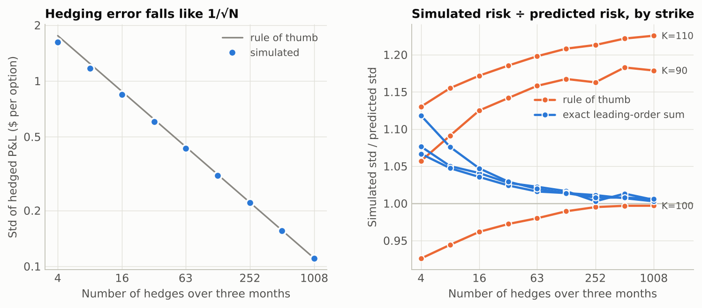
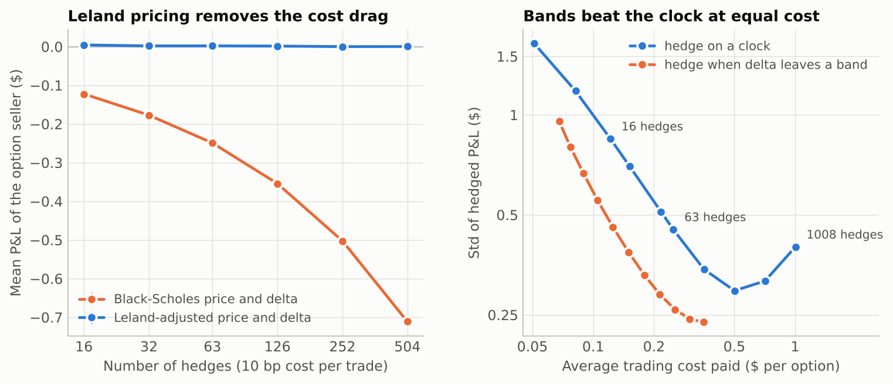
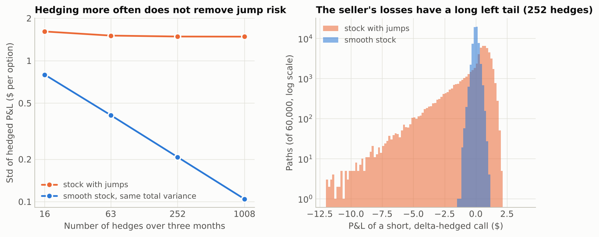
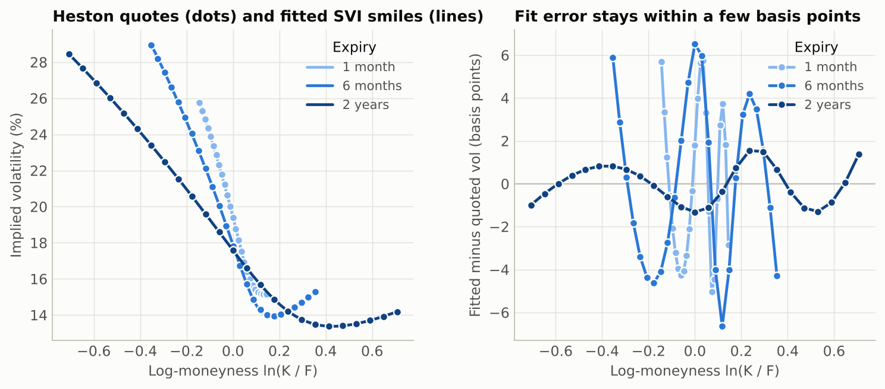

# GammaScalp research memo

**Question.** The Black-Scholes argument says an option can be replicated by
trading the stock continuously, for free. Nobody can do either. How much risk
is left when hedging is discrete, costly, and done with the wrong volatility,
and do the classical correction formulas predict it?

**Method.** One short (or long) three-month at-the-money call on a $100 stock,
20% volatility, 3% rate, premium $4.3576. Every study states a prediction
from the literature, simulates seeded paths, and reports both numbers.
12,640,000 hedging runs in total (a run is one hedger on one price path; some
studies put two hedgers or several rules on the same paths). All figures below
are synthetic: they test the formulas and the code, not any market.

## 1. Discrete hedging: risk falls like 1/sqrt(N)

Derman and Kamal (1999) predict a hedging error with mean zero and standard
deviation `sqrt(pi/4) * vega * sigma / sqrt(N)` for N evenly spaced hedges.

| Hedges | Mean P&L | ± s.e. | Std | Predicted | Ratio | Std / premium |
| ---: | ---: | ---: | ---: | ---: | ---: | ---: |
| 4 | -0.0131 | 0.0036 | 1.6240 | 1.7540 | 0.926 | 37.3% |
| 8 | -0.0048 | 0.0026 | 1.1712 | 1.2403 | 0.944 | 26.9% |
| 16 | -0.0001 | 0.0019 | 0.8435 | 0.8770 | 0.962 | 19.4% |
| 32 | +0.0004 | 0.0013 | 0.6030 | 0.6201 | 0.972 | 13.8% |
| 63 | -0.0006 | 0.0010 | 0.4331 | 0.4420 | 0.980 | 9.9% |
| 126 | -0.0013 | 0.0007 | 0.3092 | 0.3125 | 0.989 | 7.1% |
| 252 | +0.0002 | 0.0005 | 0.2199 | 0.2210 | 0.995 | 5.0% |
| 504 | -0.0001 | 0.0003 | 0.1558 | 0.1563 | 0.997 | 3.6% |
| 1008 | -0.0001 | 0.0002 | 0.1101 | 0.1105 | 0.997 | 2.5% |

- A log-log regression of std on N (16 hedges and up) gives a slope of
  **-0.491 ± 0.001**; theory says -0.5.
- At 63 hedges (daily) the simulated std is 98.0% of the formula;
  at 1,008 hedges it is 99.7%. The formula is an
  asymptotic one and overstates risk when hedges are few.
- Daily hedging still leaves a standard deviation of about
  10% of the premium.
- The mean is within two standard errors of zero except at 4 hedges (-0.30% of premium). The sign is the one the next subsection predicts for so few hedges.

**The rule of thumb is an at-the-money result.** The same experiment at
strikes 90 and 110 shows it understating risk: at 1,008 hedges the simulated
standard deviation is 18% to 23% above the formula, and the gap does not close with more hedges.
The step it skips can be done exactly: each interval contributes
`1/2 * sigma^4 * dt^2 * E[(gamma * S^2)^2]` of variance, and summing that over
the hedge dates by quadrature (`leading_order_std`) gives a prediction for any
strike.

| Strike | Hedges | Simulated std | Rule of thumb | Ratio | Exact sum | Ratio |
| ---: | ---: | ---: | ---: | ---: | ---: | ---: |
| 90 | 63 | 0.2576 | 0.2224 | 1.158 | 0.2519 | 1.022 |
| 90 | 1008 | 0.0655 | 0.0556 | 1.179 | 0.0652 | 1.005 |
| 100 | 63 | 0.4331 | 0.4420 | 0.980 | 0.4263 | 1.016 |
| 100 | 1008 | 0.1101 | 0.1105 | 0.997 | 0.1098 | 1.003 |
| 110 | 63 | 0.3787 | 0.3161 | 1.198 | 0.3714 | 1.020 |
| 110 | 1008 | 0.0969 | 0.0790 | 1.226 | 0.0963 | 1.006 |

At 1,008 hedges the exact sum is within 0.6% of the simulation at all three strikes;
at 63 hedges, within 2.2%. It is a leading-order result, so it too drifts when hedges are few.



### A second-order effect: the drift does matter a little

In continuous time a delta hedger is indifferent to the stock's drift. With N
discrete hedges the squared move over one interval averages
`sigma^2 dt + (mu - r)^2 dt^2`, so a short-gamma position pays a small extra
amount. Integrating gives a prediction for a short option:
`mean = -(mu - r)^2 * (T / N) * E[integral of 1/2 gamma S^2]`.

| Drift | Hedges | Mean P&L | ± s.e. | Predicted | % of premium |
| ---: | ---: | ---: | ---: | ---: | ---: |
| -0.50 | 63 | -0.0443 | 0.0008 | -0.0434 | -1.02% |
| -0.50 | 252 | -0.0104 | 0.0004 | -0.0109 | -0.24% |
| +0.00 | 63 | +0.0004 | 0.0010 | -0.0002 | +0.01% |
| +0.00 | 252 | -0.0011 | 0.0005 | -0.0000 | -0.02% |
| +0.50 | 63 | -0.0351 | 0.0008 | -0.0350 | -0.81% |
| +0.50 | 252 | -0.0087 | 0.0004 | -0.0087 | -0.20% |
| +1.00 | 63 | -0.0936 | 0.0006 | -0.0929 | -2.15% |
| +1.00 | 252 | -0.0235 | 0.0003 | -0.0232 | -0.54% |

The largest gap between simulation and this prediction is
2.1 standard errors. For realistic drifts the effect is
invisible; it becomes about 2.1% of premium only at a drift of 100% a year
with daily hedging.

## 2. Buying volatility cheap: where the money comes from

A call is bought at 20% implied volatility; the stock then realizes 30%. The
value of that edge is `V(30%) - V(20%)` = $1.9945 at expiry. Two hedgers
trade the same paths (Ahmad and Wilmott, 2005).

| Drift | Hedge at realized: mean | std | Hedge at implied: mean | ± s.e. | theory | std | 5% to 95% |
| ---: | ---: | ---: | ---: | ---: | ---: | ---: | ---: |
| -0.40 | 1.9950 | 0.155 | 1.8183 | 0.0029 | 1.8181 | 0.917 | 0.56 to 3.47 |
| +0.00 | 1.9943 | 0.166 | 1.9958 | 0.0029 | 1.9931 | 0.922 | 0.64 to 3.59 |
| +0.08 | 1.9948 | 0.167 | 1.9967 | 0.0029 | 1.9928 | 0.921 | 0.64 to 3.58 |
| +0.40 | 1.9958 | 0.158 | 1.8715 | 0.0029 | 1.8709 | 0.927 | 0.57 to 3.52 |

- Hedging at **realized** volatility locks in the edge: the mean equals
  `V(30%) - V(20%)` at every drift, and the spread around it is only the
  discrete-hedging noise of study 1.
- Hedging at **implied** volatility earns the gamma rent
  `1/2 * gamma * S^2 * (sigma_r^2 - sigma_i^2)` each instant. Its total depends
  on how long the stock stays near the strike, so the mean moves with drift.
  The quadrature of that integral matches the simulated mean in every row.
- Per path, the gamma-rent sum explains the simulated P&L with a correlation of
  at least 0.9996.
- Share of paths on which the implied-vol hedger lost money: at most
  0.00%. The outcome is uncertain in size, not in sign.


## 3. Trading costs: what to charge, and when to trade

With a proportional cost of 10 basis points per trade, a seller who charges
the Black-Scholes price loses the cost of hedging. Leland (1985) says to price
and hedge with `sigma^2 * (1 + sqrt(8/pi) * cost / (sigma * sqrt(dt)))`.

| Hedges | Leland number | Adjusted vol | Leland markup | Plain hedge cost | Naive mean | Leland mean | ± s.e. |
| ---: | ---: | ---: | ---: | ---: | ---: | ---: | ---: |
| 16 | 0.064 | 20.63% | 0.1253 | 0.1220 | -0.1225 | +0.0043 | 0.0019 |
| 32 | 0.090 | 20.88% | 0.1761 | 0.1765 | -0.1773 | +0.0019 | 0.0014 |
| 63 | 0.127 | 21.23% | 0.2451 | 0.2496 | -0.2492 | +0.0020 | 0.0010 |
| 126 | 0.179 | 21.72% | 0.3425 | 0.3549 | -0.3542 | +0.0014 | 0.0007 |
| 252 | 0.253 | 22.39% | 0.4767 | 0.5022 | -0.5024 | +0.0000 | 0.0005 |
| 504 | 0.358 | 23.31% | 0.6599 | 0.7113 | -0.7110 | +0.0002 | 0.0004 |

- The adjusted price brings the seller's mean P&L back to within
  0.10% of the premium at every frequency tested.
- The markup is what the adjusted hedge costs, not what the unadjusted hedge
  costs. At 504 hedges the seller who keeps the plain Black-Scholes delta pays
  7.8% more than the markup, because hedging at the higher volatility
  also flattens gamma and so trades less. At 16 hedges the two differ by
  2.6%.

Costs make "hedge more often" a trade-off. Two rules were run on the same
40,000 paths: hedge on a clock, or watch continuously and trade only
when delta leaves a band (Whalley and Wilmott, 1997), trading back to the
band's edge.

| Risk aversion | Avg cost | Band std | Clock std at same cost | Risk reduction |
| ---: | ---: | ---: | ---: | ---: |
| 0.05 | 0.0678 | 0.9562 | 1.3450 | 28.9% |
| 0.1 | 0.0772 | 0.8004 | 1.2287 | 34.9% |
| 0.2 | 0.0894 | 0.6665 | 1.0949 | 39.1% |
| 0.4 | 0.1052 | 0.5525 | 0.9562 | 42.2% |
| 0.8 | 0.1251 | 0.4598 | 0.8270 | 44.4% |
| 1.6 | 0.1496 | 0.3865 | 0.7080 | 45.4% |
| 3.2 | 0.1790 | 0.3299 | 0.6044 | 45.4% |
| 6.4 | 0.2140 | 0.2879 | 0.5167 | 44.3% |
| 12.8 | 0.2545 | 0.2592 | 0.4444 | 41.7% |
| 25.6 | 0.3006 | 0.2429 | 0.3897 | 37.7% |
| 51.2 | 0.3519 | 0.2377 | 0.3442 | 30.9% |

At equal average cost the band rule carried 29% to
45% less risk than the clock rule (largest at a cost of
$0.18). The clock rule's risk also stops improving past a few hundred
hedges, because the cost itself becomes a source of variance. The clock
curve is interpolated between tested frequencies, and the band is the
small-cost asymptotic formula, not a numerically optimal one.



## 4. Jumps: the risk delta hedging cannot remove

A stock with four jumps a year on average (mean -2%, std 6%) is compared with a
smooth stock of the same total variance (18.9% volatility). The
option is sold at its fair Merton price, so both sellers break even on average.

| Hedges | Smooth std | Jump std | Jump skew | Smooth 1% worst | Jump 1% worst | Jump mean | ± s.e. |
| ---: | ---: | ---: | ---: | ---: | ---: | ---: | ---: |
| 16 | 0.796 | 1.611 | -2.09 | -2.19 | -5.95 | -0.0031 | 0.0036 |
| 63 | 0.411 | 1.506 | -2.42 | -1.11 | -5.77 | +0.0044 | 0.0034 |
| 252 | 0.207 | 1.483 | -2.53 | -0.55 | -5.73 | +0.0008 | 0.0033 |
| 1008 | 0.104 | 1.481 | -2.57 | -0.28 | -5.79 | +0.0019 | 0.0033 |

Going from 16 to 1008 hedges cut the smooth stock's risk by
87% and the jumping stock's by 8%.
At the highest frequency the seller's 1%-worst outcome is
21 times larger with jumps. A gap moves the stock before
the hedge can follow; only owning other options removes that risk.



## 5. From prices to an arbitrage-free smile

**Implied volatility.** 1,000,000 random options were priced and
inverted at 779,536 options per second on the recorded
machine. Accuracy is limited by floating point, not by the solver:

| Time value above (× forward) | Options | Solved | Max abs error | Median abs error |
| ---: | ---: | ---: | ---: | ---: |
| 0.0001 | 897,024 | 897,024 | 3.0e-13 | 2.2e-16 |
| 1e-06 | 928,459 | 928,459 | 2.6e-11 | 2.2e-16 |
| 1e-08 | 944,070 | 944,070 | 9.4e-10 | 2.2e-16 |
| 1e-10 | 953,607 | 953,607 | 1.2e-07 | 2.2e-16 |

**Smile fitting.** Option chains were generated from a Heston model
(kappa 2, theta 0.04, xi 0.6, rho -0.7), five expiries of 25 strikes each,
and a raw SVI slice was fitted to each expiry.

| Quote noise (vol bp) | Fits | RMSE vs quotes (bp) | RMSE vs true smile (bp) |
| ---: | ---: | ---: | ---: |
| 0 | 5 | 2.94 | 2.94 |
| 10 | 100 | 9.37 | 5.44 |
| 30 | 100 | 26.41 | 13.58 |

- Clean quotes are fitted to 2.9 basis points on average
  (worst expiry 5.8). SVI is not the Heston smile, so the error is not zero.
- With noisy quotes the fit is closer to the true smile than the quotes are:
  five parameters average out the noise of 25 strikes.
- 0 of 205 fitted slices show butterfly arbitrage
  inside the quoted strike range, and the worst calendar violation is 0.
  The test suite confirms the detector does fire on a published arbitrageable smile.



## Limitations

- Every result is a simulation under a stated model. Nothing here is a backtest
  or evidence that a strategy makes money in a real market.
- One option, one maturity, constant rates, no dividends in the hedging
  studies, no bid-ask spread on the option, and costs proportional to notional.
- The jump and volatility-mismatch studies give the hedger a volatility number
  it could not know in advance.
- Standard errors describe Monte Carlo noise only. Comparing many table rows
  to theory was not corrected for multiple comparisons.
- The Leland and Whalley-Wilmott formulas are small-cost approximations; the
  comparison with them is a check of their accuracy in one configuration.

## Reproduce

```bash
python -m gammascalp research        # about 9 minutes; writes results/
python scripts/build_report.py       # figures and this memo
```

Versions used for the delivered run: Python 3.13.16, NumPy 2.5.3,
SciPy 1.18.1, Matplotlib 3.11.2. Seeds are fixed in
`experiments.py`; other library versions can change the last digits.

## References

- Ahmad, R. and Wilmott, P. (2005). Which free lunch would you like today, sir? *Wilmott Magazine*.
- Albrecher, H., Mayer, P., Schoutens, W. and Tistaert, J. (2007). The little Heston trap. *Wilmott Magazine*.
- Broadie, M. and Detemple, J. (1996). American option valuation. *Review of Financial Studies* 9.
- Derman, E. and Kamal, M. (1999). When you cannot hedge continuously. Goldman Sachs Quantitative Strategies Research Notes.
- Gatheral, J. and Jacquier, A. (2014). Arbitrage-free SVI volatility surfaces. *Quantitative Finance* 14.
- Heston, S. (1993). A closed-form solution for options with stochastic volatility. *Review of Financial Studies* 6.
- Leland, H. (1985). Option pricing and replication with transactions costs. *Journal of Finance* 40.
- Lewis, A. (2001). A simple option formula for general jump-diffusion and other exponential Levy processes.
- Manaster, S. and Koehler, G. (1982). The calculation of implied variances from the Black-Scholes model. *Journal of Finance* 37.
- Merton, R. (1976). Option pricing when underlying stock returns are discontinuous. *Journal of Financial Economics* 3.
- Whalley, A. E. and Wilmott, P. (1997). An asymptotic analysis of an optimal hedging model for option pricing with transaction costs. *Mathematical Finance* 7.
